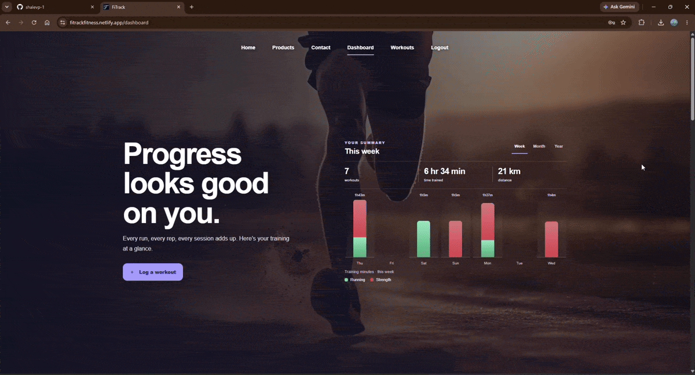
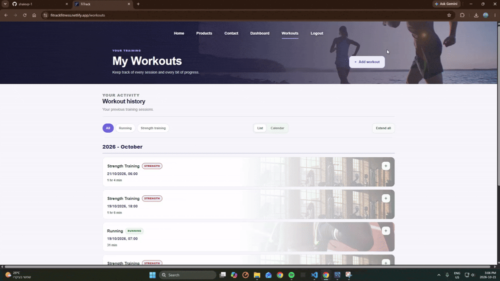
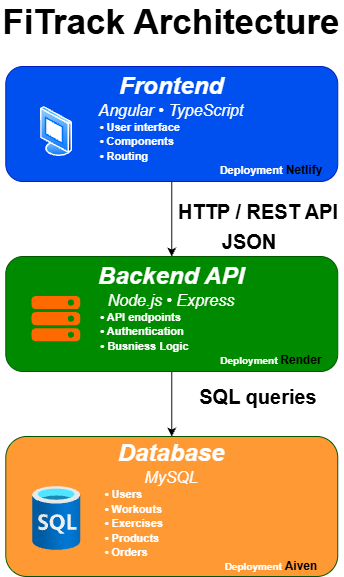
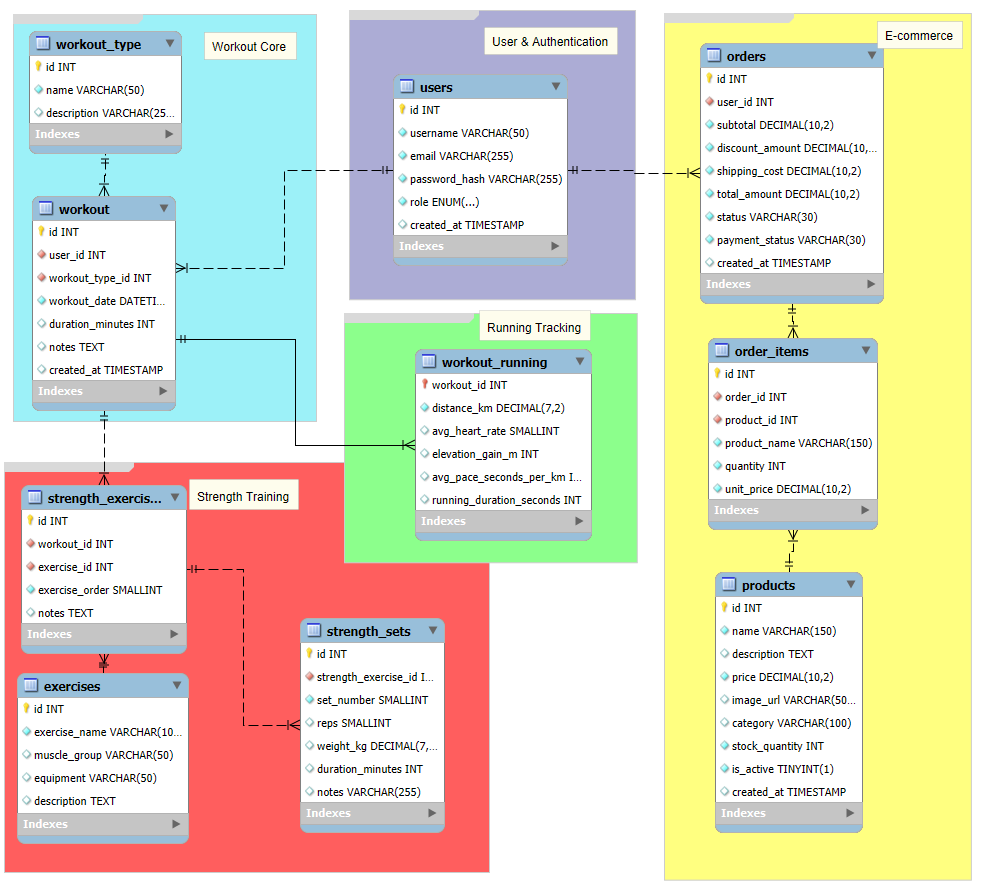

# FiTrack

**A full-stack fitness tracking and product management application**

FiTrack helps users record running and strength workouts, review their training history, and follow their progress through a visual dashboard. It also includes a product catalog, checkout and order history, and an administrator inventory workflow.

[Open the live application](https://fitrackfitness.netlify.app/home) · [View the source on GitHub](https://github.com/shalevp-1/FiTrack)


## Demo Access

Explore FiTrack using the live application and demo accounts below.

**Live application:** [Open FiTrack](https://fitrackfitness.netlify.app/home)

### Regular User

- **Username:** `demo`
- **Password:** `demo`

Explore the dashboard, running and strength workouts, workout history, product catalog, checkout, and order history using sample data.

### Admin

- **Username:** `admin`
- **Password:** `admin`

Explore product management, inventory tracking, and restocking workflows.

Both accounts use demo data and are intended for evaluation purposes only.


## Product tour

### Fitness dashboard

Workout summaries and visualizations give users an overview of their training activity.



### Workout tracking

- **Workout tracking:** Create, view, edit, and delete running and strength workouts, including workout-specific metrics and exercise sets.
- **Workout history and calendar:** Review workout details on the dashboard and explore training sessions in a dedicated calendar.



### Admin inventory

Administrators can add, update, and delete products, manage inventory levels, and restock existing products without creating duplicates.


## Features

- **Authentication and authorization:** Account registration and login, authenticated routes, and role-protected administrator operations.
- **Workout tracking:** Create, review, edit, and delete running and strength workouts.
- **Progress dashboard:** Review workout activity and fitness summaries.
- **Product catalog and checkout:** Browse products, manage a cart, place orders, and view order history.
- **Inventory administration:** Search and filter products by stock status, add or edit product details, restock products, and deactivate products.
- **Low-stock visibility:** Inventory warnings use a five-unit threshold.

## Technology

| Area | Technologies |
|---|---|
| Frontend | Angular, TypeScript, RxJS, HTML, CSS |
| Backend | Node.js, Express |
| Database | MySQL with `mysql2` |
| Authentication | JWT in an HTTP-only cookie; bcrypt password hashing |
| Hosting | Netlify (frontend), Render (API), Aiven (MySQL) |

## Architecture

The frontend communicates with the Express REST API over HTTP. The API handles authentication, authorization, validation, application logic, and SQL operations against MySQL.



The relational data model covers users, workouts, running details, strength exercises and sets, products, and orders.



## Run locally

### Prerequisites

- Node.js 20 or later
- A MySQL database initialized with the FiTrack tables

### 1. Configure and start the API

From the repository root:

```powershell
cd backend
npm install
```

Create `backend/.env` with the database connection details and a strong JWT secret:

```dotenv
PORT=3000
NODE_ENV=development
JWT_SECRET=replace-with-a-random-secret-of-at-least-32-bytes
CLIENT_ORIGINS=http://localhost:4200

DB_HOST=localhost
DB_PORT=3306
DB_USER=your_mysql_user
DB_PASSWORD=your_mysql_password
DB_NAME=fitrack
```

Start the API:

```powershell
npm start
```

The backend requires `DB_HOST`, `DB_USER`, `DB_PASSWORD`, and `DB_NAME`. `JWT_SECRET` must contain at least 32 bytes. In production, configure `DB_SSL_CA` for the database TLS certificate as well. Keep `.env` files and real credentials out of source control.

### 2. Start the Angular frontend

In a second terminal, from the repository root:

```powershell
cd frontend
npm install
npm start
```

The Angular development server runs at `http://localhost:4200` and proxies `/api` requests to the local backend at `http://localhost:3000`.

### Build and frontend tests

Run these commands from `frontend`:

```powershell
npm run build
npx ng test --watch=false
```

## Deployment

The frontend is configured for Netlify using the repository’s `netlify.toml`; the backend runs as a separate Express service, and MySQL is hosted separately. Configure production secrets and database settings in the hosting providers’ environment-variable settings rather than committing them.

## Security notes

- Passwords are hashed with bcrypt.
- Authentication tokens are issued in HTTP-only cookies.
- Administrator API routes enforce authentication and the admin role on the backend.
- SQL queries use parameterized values for user-provided data.
- JWT, database, and production TLS configuration must be supplied through environment variables.
